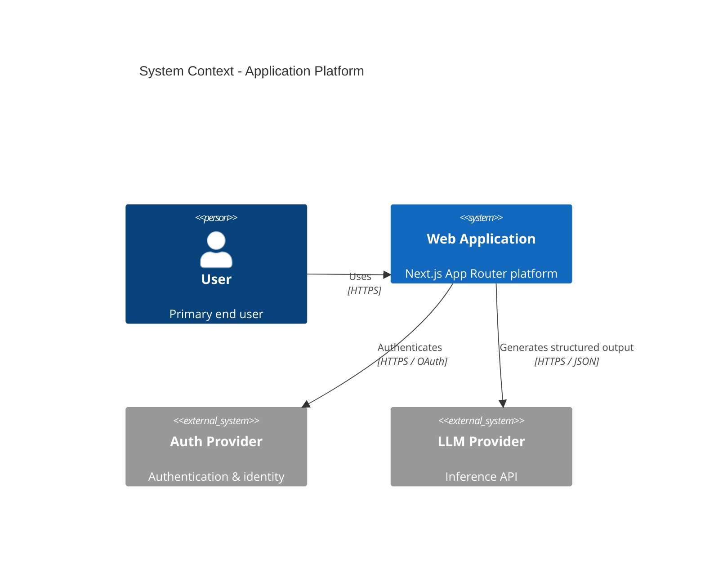
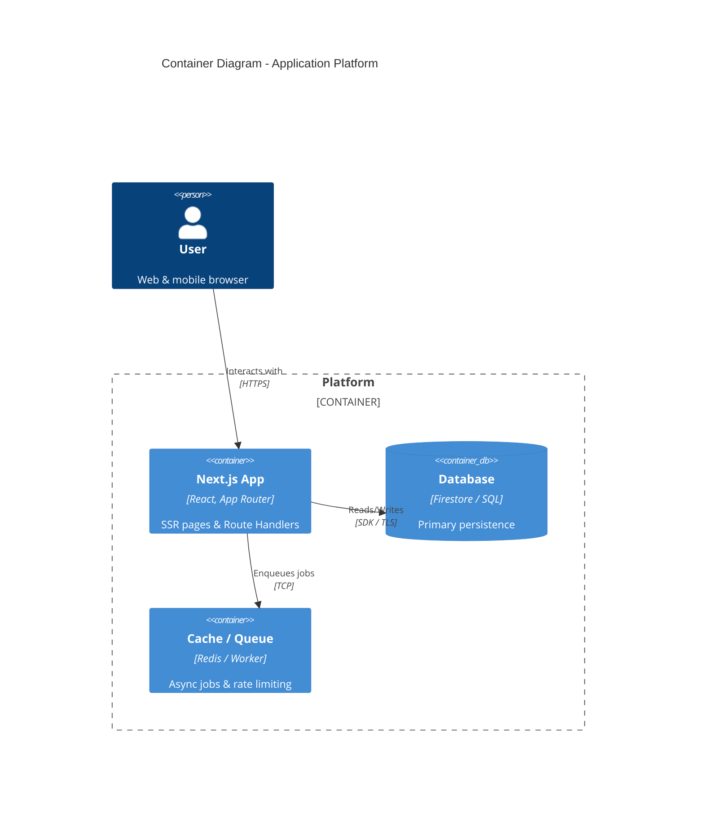
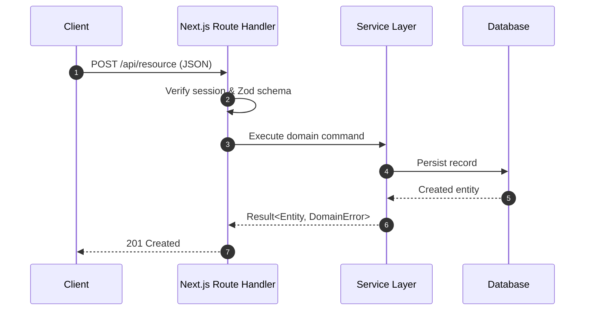

# Technical Diagram Expert

Generate clear, accurate architecture diagrams and technical visualizations using C4 model and Mermaid syntax. Keep every diagram at a single level of abstraction and verify all depicted components and relationships against actual codebase evidence.

## 1. Choosing the Right Diagram

### C4 Model (Architecture Documentation)

| Level | Diagram | Audience | Shows | When to Create |
| :---: | :--- | :--- | :--- | :--- |
| 1 | `C4Context` | Everyone | System, users, external systems | Always for system docs |
| 2 | `C4Container` | Technical | Apps, APIs, DBs, queues | Always for architecture |
| 3 | `C4Component` | Developers | Internal modules/services | Only when adding clarity |
| 4 | `C4Deployment` | DevOps/Infra | Runtime nodes, hosting, CDNs | Production/infra docs |
| — | `C4Dynamic` | Technical | Numbered request/event flows | Complex runtime flows |

> Rule of thumb: `C4Context` + `C4Container` are sufficient for most teams.

### General Mermaid Diagrams

| Use Case | Mermaid Type |
| :--- | :--- |
| User/process flows, decision trees | `flowchart TD` / `flowchart LR` |
| API & service-to-service interactions | `sequenceDiagram` |
| Database / domain data models | `erDiagram` |
| Lifecycle / state transitions | `stateDiagram-v2` |
| Project timelines / milestones | `gantt` |

## 2. C4 Mermaid Templates

### System Context (Level 1)

### Container Diagram (Level 2)

### Dynamic Flow (Sequence Alternative)

## 3. Quality Rules

- **Ground in reality:** Every container, route, and store must match actual files or approved design specs.
- **Label every arrow:** Specify action and protocol (`Reads/Writes`, `HTTPS / JSON`, `Server Action`).
- **Quote special characters:** Wrap labels containing parentheses or brackets in quotes (`id["Label (Detail)"]`).
- **Keep readable:** Split diagrams exceeding ~12–15 nodes by bounded context or flow.
