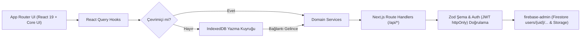

# Umay — Ev Envanter, Stok Defteri & Ömürlü Parça Takip Platformu

> **"Evin bereketi, kayıt altında."** — _Your home's abundance, accounted for._

**Umay**; mutfak erzaklarından elektronik cihazlara, çekmecedeki kablolardan su arıtma filtresi ve robot süpürge fırçası gibi ömürlü yedek parçalara kadar evdeki tüm varlıkları tek bir sakin arayüzde yöneten, **çevrimdışı hazır (PWA)** ve **mobil öncelikli** bir ev envanter sistemidir.

Karmaşık tablolar veya gürültülü paneller yerine **"sakin ocak başı düzeni"** felsefesiyle tasarlanmıştır: her şey yolundayken arayüz sessiz kalır; yalnızca stok azaldığında, son kullanma tarihi yaklaştığında veya bir parçanın bakım zamanı geldiğinde nazikçe dikkat çeker.

---

## Çözdüğü Problemler

Ev yönetiminde dağınık notlar ve unutulan bakımlar hem israfa hem de gereksiz alışverişe yol açar. Umay şu temel sorunlara doğrudan çözüm üretir:

| Günlük Problem                                                           | Umay'ın Çözümü                                                                                                                                                    |
| :----------------------------------------------------------------------- | :---------------------------------------------------------------------------------------------------------------------------------------------------------------- |
| **"Bu kablo / yedek parça hangi dolaptaydı?"**                           | Hiyerarşik konum ağacı (`Ev > Mutfak > Üst Dolap`), kategoriye özel teknik alanlar, yazdırılabilir QR raf etiketleri ve `Ctrl/⌘+K` komut paleti ile anında arama. |
| **"Stok sayıları zamanla tutarsızlaşıyor"**                              | Doğrudan sayı ezmek yerine her artırma, azaltma ve tüketimi **atomik stok hareketi** olarak kaydeden defter mimarisi ve tam faaliyet günlüğü (`/activity`).       |
| **"Su arıtma filtresini / diş fırçası başlığını ne zaman değiştirdim?"** | Zamana (gün) veya kullanıma (litre, baskı, saat) dayalı **ömürlü parça takibi**, 2 dokunuşla değişim kaydı ve yedek stoktan otomatik düşüm.                       |
| **"Evde varken aynısından tekrar aldık / SKT'si geçti"**                 | Minimum stok eşiği, **FEFO** (İlk Giren/Biten İlk Çıkar) SKT uyarıları, otomatik alışveriş listesi ve yapay zekâ destekli **fiş analizi**.                        |
| **"Kilerde veya bodrumda internet çekmiyor"**                            | Service Worker (`public/sw.js`) ve IndexedDB çevrimdışı yazma kuyruğu ile internet yokken bile okuma ve stok güncelleme; bağlantı geldiğinde otomatik eşitleme.   |

---

## Neler Yapar ve Neler Yapabilir?

### 1. Envanter & Atomik Stok Defteri (`/items`, `/items/[id]`)

- **Tek Dokunuşla Hareket:** `+ / −` ve tüketim eylemleriyle anlık stok güncelleme; her işlem kullanıcı tarihçesine işlenir.
- **Esnek Kategori Şablonları (`/categories`):** Kablo uzunluğu, konnektör tipi, seri numarası, garanti bitiş tarihi veya SKT gibi kategoriye özel alanlar tanımlama.
- **Akıllı Durum Göstergeleri:** Yeterli stokta rozet göstermez ("sessizlik = iyi"); yalnızca düşük stok (`low_stock`), tükenme (`out_of_stock`) ve yaklaşan SKT durumlarında ikon + metin + renk ile uyarır.

### 2. Ömürlü Parça Yaşam Döngüsü (`/parts`, `/parts/[id]`)

- **Ana Cihaza Bağlı Parçalar:** Filtre, pil, kartuş ve sarf malzemelerini bağlı oldukları ana ürüne (örn. arıtma cihazı, robot süpürge) bağlar.
- **Kalan Ömür Çubuğu (`LifecycleProgressBar`):** `Europe/Istanbul` saat diliminde planlanan vs. gerçekleşen ömür ve maliyet analizi sunar.
- **2 Dokunuşla Değişim & Yedek Düşümü:** Parça değiştirildiğinde yeni döngüyü başlatır, varsa yedek stoğundan 1 adet düşer ve geçmişi kaydeder.
- **Otomatik Yenileme İşi (`/api/jobs/refresh-parts`):** `CRON_SECRET` korumalı zamanlanmış görevle parça durumlarını (`ok` / `due_soon` / `overdue`) güncel tutar.

### 3. Akıllı Alışveriş Listesi & Yapay Zekâ Fiş Analizi (`/shopping`)

- **Otomatik Öneriler:** Minimum stok eşiğinin altına düşen ürünler ve değişim zamanı yaklaşan/geciken parçalar alışveriş listesine öneri olarak düşer.
- **OpenRouter Vision Fiş Asistanı (`/api/ai/receipt/analyze`):** Market veya teknik alışveriş fişinin fotoğrafından ham OCR metni ve yapılandırılmış kalemler (ürün, adet, tutar, tarih) çıkarır; ücretsiz vision model fallback zinciriyle çalışır.

### 4. Barkod / QR Tarayıcı & Etiket Baskısı (`/scan`)

- **Çift Motorlu Kamera Okuma:** Tarayıcının yerleşik `BarcodeDetector` API'sini kullanır; desteklemeyen cihazlarda otomatik olarak `@zxing/browser` fallback'ine geçer.
- **QR Etiket Üretimi:** `qrcode` altyapısıyla dolaplar, kutular ve ürünler için yazdırılabilir QR etiketler üretir.

### 5. Konumlar, Güvenlik & Veri Taşınabilirliği (`/locations`, `/settings`)

- **Tam Veri İzolasyonu:** Tüm Firestore belgeleri sunucu tarafında oturum `uid` değeriyle izole edilir (`users/{uid}/...`); istemciden gelen kimlik bilgilerine asla güvenilmez.
- **Tam Yedekleme:** Tüm envanteri tek tıkla **CSV** veya **JSON** olarak dışa/içe aktarma imkânı sunar.
- **Çok Dilli & Çift Tema:** Türkçe (`tr`) ve İngilizce (`en`) arayüz; Açık, Koyu ve Sistem teması (`next-themes`) desteği.

---

## Sistem Mimarisi

Umay, katı katman ayrımı ve çift taraflı doğrulama üzerine kuruludur:



### Temel Mimari İlkeler

- **Tasarım Sistemi (`docs/design.md`):** Sıcak nötr yüzeyler (`#FAF8F5` açık / `#121110` koyu), gök mavisi tek vurgu (`--accent`), `Manrope` + `Inter` + `JetBrains Mono` tipografi ve WCAG AA (≥ 4.5:1) kontrast garantisi (`tests/design/contrast.test.ts`).
- **Modülerlik & Kalite Standartları (`AGENTS.md`):** Tüm kaynak dosyalar 250 satır sınırının altında tutulur; raw HTML kontrolleri yerine `@/components/core/*` ve `@/components/forms/*` bileşenleri kullanılır; TypeScript katı modda sıfır `any` ile derlenir.
- **Özel Rota Yüzeyleri:** Tüm App Router segmentlerinde standart `loading.tsx`, `error.tsx`, `not-found.tsx` ve dinamik/statik SEO `metadata` tanımlıdır.

---

## Teknoloji Yığını

| Katman                   | Teknolojiler                                                                              |
| :----------------------- | :---------------------------------------------------------------------------------------- |
| **Çatı & Dil**           | Next.js 16 (App Router, Turbopack), React 19, TypeScript (Strict)                         |
| **Stil & Bileşenler**    | Tailwind CSS, Radix UI tabanlı `@/components/core`, `lucide-react`, `next-themes`         |
| **Durum & Formlar**      | TanStack React Query v5, Zustand (`umay-auth-storage`), React Hook Form + Zod             |
| **Backend & Veritabanı** | Next.js Route Handlers (`/api/*`), `firebase-admin` (Firestore & Storage)                 |
| **Kimlik Doğrulama**     | Firebase Authentication (Google & E-posta/Şifre) + sunucu tarafı JWT `httpOnly` çerez     |
| **Yapay Zekâ & Görüntü** | OpenRouter API (Vision + Text fallback zinciri)                                           |
| **Barkod, QR & PWA**     | `BarcodeDetector`, `@zxing/browser`, `qrcode`, Service Worker (`public/sw.js`), IndexedDB |
| **Test & Kalite**        | Vitest, ESLint 9 (Flat Config), Prettier, `tsc --noEmit`                                  |

---

## Proje Yapısı

```text
src/
├── app/
│   ├── (public)/          # One-page anasayfa (/)
│   ├── (auth)/            # Giriş, kayıt ve korumalı uygulama rotaları (/home, /items, /parts, /locations, /shopping, /scan, /activity, /settings)
│   └── api/               # Auth, AI fiş analizi, envanter CRUD, yedekleme ve cron job uç noktaları
├── components/
│   ├── core/              # Radix tabanlı çekirdek UI bileşenleri (Button, Card, Table, StatusPill, Progress vb.)
│   ├── forms/             # react-hook-form + zod bağlı standart form alanları
│   ├── layout/            # AppShell, CommandPalette (Ctrl/⌘+K), ThemeToggle, LanguageSwitcher
│   ├── ai/                # Fiş analizi yardımcı bileşenleri
│   └── providers/         # Query, Theme ve PWA Offline sağlayıcıları
├── features/              # Ekran ve iş mantığı modülleri (i18n, tipler, alt bileşenler)
├── hooks/                 # React Query ve domain kancaları
├── lib/                   # Firebase client/admin, AI provider, tasarım token'ları, lifecycle ve offline kuyruk
├── services/              # İstemci API servis katmanı
└── stores/                # Zustand oturum deposu
```

---

## Hızlı Kurulum

### 1. Bağımlılıkları Yükle

```bash
npm install
```

### 2. Ortam Değişkenlerini (`.env`) Yapılandır

`.env.example` dosyasını `.env` olarak kopyala ve kendi değerlerinle güncelle:

```bash
cp .env.example .env
```

- **Firebase Web & Admin:** `NEXT_PUBLIC_FIREBASE_*` değişkenlerini Firebase Console → Project Settings altından al; sunucu tarafı için `FIREBASE_PROJECT_ID`, `FIREBASE_CLIENT_EMAIL` ve `FIREBASE_PRIVATE_KEY` değerlerini ekle.
- **Güvenlik & Cron:** Production ortamında güçlü bir `JWT_SECRET` ve `/api/jobs/refresh-parts` için `CRON_SECRET` belirle.
- **Yapay Zekâ Fiş Analizi (İsteğe Bağlı):** Fiş okuma özelliğini kullanmak için `OPENROUTER_API_KEY` ekle.

### 3. Yerel Geliştirme & Örnek Veri (Firebase Emulator)

```bash
firebase emulators:start
```

İkinci bir terminalde örnek Türkçe ev envanteri verilerini yükle:

```bash
npx tsx scripts/seed.ts
```

### 4. Uygulamayı Başlat

```bash
npm run dev
```

Uygulama `http://localhost:3000` adresinde açılır.

---

## Doğrulama & Kalite Kapısı Komutları

Değişikliklerden sonra tüm kalite kontrollerini çalıştırmak için:

```bash
npm run type-check       # TypeScript tip kontrolü (tsc --noEmit)
npm run lint             # ESLint 9 denetimi
npm run test             # Vitest birim ve kontrast testleri
npm run metadata:check   # Tüm App Router rotalarının metadata doğrulaması
npm run build            # Production derlemesi
```

---

## Ek Belgeler

- [Tasarım Rehberi (`docs/design.md`)](docs/design.md) — Renk token'ları, tipografi ve bileşen ilkeleri
- [Mimari & Çalışma Kuralları (`AGENTS.md`)](AGENTS.md) — Proje bağlamı, modülerlik, form, TypeScript ve production checklist standartları
